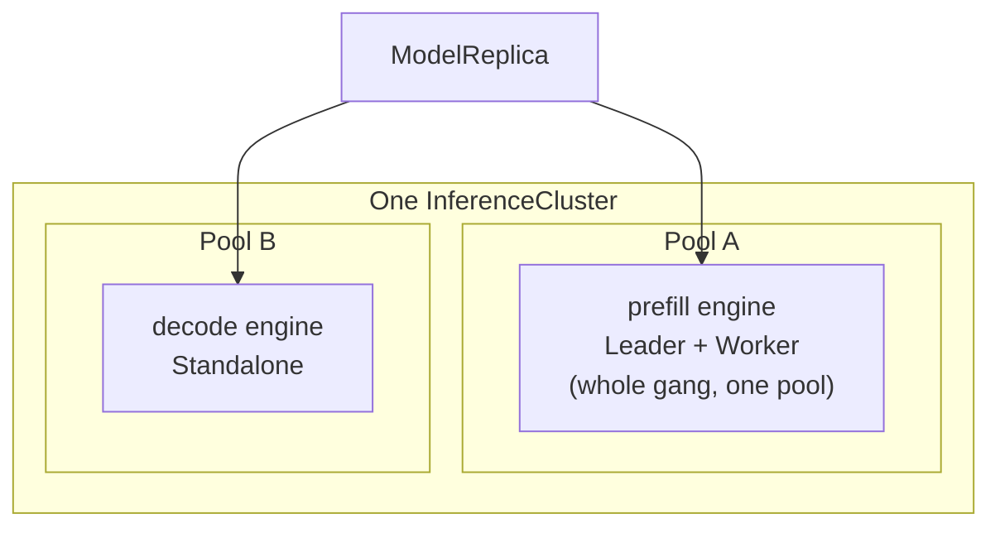

**API:** [`modelplane.ai/v1alpha1` · ModelDeployment]()
<!-- vale write-good.Passive = NO -->
When an ML team creates a [ModelDeployment](),
the fleet scheduler picks the cluster each replica runs on and the node pool
each engine uses. Platform teams don't drive it directly, but what they
publish, the clusters, their labels, and each pool's
[InferenceClass](), is exactly what the
scheduler matches against. This page explains how it places work and where it
deliberately stops short, so you can reason about why a deployment landed where it
did.

## A pure function of observed state

The scheduler recomputes the whole placement from scratch on every reconcile. It
reads the deployment, every `InferenceCluster` with its published capacity, and
every existing `ModelReplica`, and returns a placement. Given the same inputs it
returns the same placement, so it's safe to run continuously.

The key consequence is stability. Existing replicas are *inputs*, not decisions.
The scheduler never moves a replica to improve the global picture, even if a
better cluster appears later. This keeps placement from churning underneath a
running deployment.

## Two-level matching

The scheduler picks a `(cluster, pool)` for each replica in two stages, matching
against what the platform team published.

1. **Clusters** are filtered by `clusterSelector.matchLabels` against the
   standard Kubernetes labels on each `InferenceCluster`: tier, region, provider,
   compliance posture. This is organizational metadata, so string equality is
   enough. An unset selector matches every cluster.
2. **Pools** are filtered by matching each device request in a member's
   `nodeSelector.devices` against the devices a pool's `InferenceClass` publishes.
   A request is a real DRA request: a `count` and CEL selectors over a device's
   attributes and capacity, such as "a GPU with at least 141Gi of memory." A pool
   fits a member when it satisfies each request, with enough matching devices to
   cover its `count`.

The CEL is the same expression an ML engineer would write in a DRA
`ResourceClaim`, evaluated against the devices the `InferenceClass` declares. The
keys a platform team puts on a class are the contract: a `nodeSelector` matches a
pool only if the class publishes the attributes and capacity it asks for.

## Co-scheduling and pools

A replica is a set of engines placed together on one cluster. Within a replica,
every member of an engine is placed on **one** pool: each member has its own
`nodeSelector`, but the scheduler only places the engine on a pool that
satisfies them all.

It works this way because a gang's members coordinate over their pool's
interconnect fabric, and the scheduler can't reason about fabric. Pool identity
is the finest grain it has. An engine split across pools risks landing its
members on different fabrics. The collective then never forms, and the gang hangs
with no clear error. To avoid that, the scheduler never splits an engine: an engine that no
single pool satisfies isn't scheduled on that cluster. Different engines of the same replica
can use different pools, but all on the same cluster.



A member with no `nodeSelector` doesn't claim any devices. It matches the
engine's pool without taking any of its capacity, and the cluster's own
scheduler places its pods on any of the pool's nodes.

## Counting free devices

The scheduler places a replica only where each of its pods fits on a node with
enough of the devices it claims free. A member runs this many pods, each
claiming the devices its `nodeSelector` resolves:

```text
pods = copies × (1 for a Standalone or Leader, or worker.nodes for a Worker)
```

The cluster's scheduler is free to bind a gang's pods to one node, so the
scheduler lets them share a node like any other pods.

A cluster agent, which the serving stack installs on every `InferenceCluster`,
reports how many of each NVIDIA GPU pool's nodes have each number of free
devices. The `InferenceCluster` publishes that histogram in its status:

```yaml
status:
  schedulablePools:
  - name: gpu-l4x4-a
    nodes: 3          # The most nodes the pool can have.
    observedNodes: 1  # The nodes the pool has now, ready or not.
    nodesByFreeDevices:
    - freeDevices:
        gpu.nvidia.com: 1
      nodes: 1
    devices:
    - name: gpu
      claim: DRA
      driver: gpu.nvidia.com
      deviceClassName: gpu.nvidia.com
      count: 4
```

A replica claiming one GPU fits this pool's node, as do two replicas claiming
four GPUs each, on the two nodes the pool can still grow by. Pods share a node
whenever it has the devices for them, so four one-GPU replicas fit one four-GPU
node. A pod that claims GPUs and network devices fits only a node with enough
of both free. The histogram leaves out cordoned and unready nodes, and nodes
with taints Modelplane's GPU pods don't tolerate. It counts the devices
scheduled pods hold as taken, and the scheduler doesn't charge a pool for them
twice.

The scheduler counts a pool in whole nodes when the agent hasn't reported on it
or can't observe it. The agent doesn't observe CPU or AMD GPU pools yet, so
they're always counted in whole nodes. Such a pool publishes no
`observedNodes`, and every node it can have starts empty. A pod that claims any
device takes a whole one.

## Pinning placement to a pool

The scheduler's pool choice is enforced, not advisory. Each scheduled pod has a
Kubernetes `nodeSelector` on the `modelplane.ai/pool` node label, so it can only
land on the pool the scheduler chose. Without it, the cluster's scheduler could
place a pod on any pool whose devices match its DRA claim, and the fleet's
per-pool accounting would drift from where pods actually run.

Modelplane labels the nodes of every pool it provisions. On a BYO
(`source: Existing`) cluster it doesn't provision the nodes, so the operator must
label each pool's nodes `modelplane.ai/pool=<nodePools[].name>` themselves, or
worker pods for that pool stay `Pending`.

## Scaling, retention, and re-placement

Scheduling runs in two phases each reconcile:

<!-- vale write-good.TooWordy = NO -->
- **Retain.** Each existing replica keeps its cluster if the cluster still exists
  and every member's pinned pool still matches its (possibly edited)
  `nodeSelector`. A degraded cluster, one that's not Ready or has no gateway
  address, is still retained; transient outages surface through the deployment's
  conditions, not re-placement.
- **Fill.** If the deployment specifies more replicas than were retained, the
  shortfall is placed one at a time, each onto the eligible cluster hosting the
  fewest of this deployment's replicas, spreading before packing. If it
  specifies fewer, the highest-index replicas are dropped first.
<!-- vale write-good.TooWordy = YES -->

A replica never changes cluster. If its cluster is deleted, the replica stops
being emitted, Crossplane garbage-collects it, and the fill phase creates a new
replica elsewhere. Moving is always delete-plus-create, mirroring how Kubernetes
treats a pod whose node is gone.

## Known limitations

The scheduler is built to be conservative and predictable rather than optimal,
and has these limits:

- **An engine can't span pools, even on one fabric**
  ([#149](https://github.com/modelplaneai/modelplane/issues/149)). Because the
  scheduler has no concept of fabric, it refuses to split a gang across pools at
  all. That forecloses a legitimate case, GPU workers on one pool and a no-GPU
  coordinator on another within the same fabric, until fabric-aware placement
  lands.
- **A wrong prediction can leave a replica Pending.** The scheduler assumes each
  pod binds to the node with the most of its claimed devices free, and the
  cluster's scheduler may bind pods of different sizes differently. A replica
  left without room for its pods waits in Pending until devices free up, and its
  `ModelPodsScheduled` condition says why. The scheduler doesn't move it to
  another cluster.
- **A pool looks fuller than it is while its agent is down.** If the cluster agent stops
  reporting, the `InferenceCluster` keeps publishing what it last saw. The
  scheduler goes on charging every replica it places on the pool, and GPUs that
  replicas free still count as taken, until the agent reports again.
- **Modelplane doesn't request CPU or memory for engines.** Unless a deployment
  sets requests on its engine containers, replicas that share a node compete for
  both, and Kubernetes evicts them first under memory pressure.
- **A rollout can need room for a new pod.** An engine that runs as a Deployment
  of fewer than four copies starts each new pod before it stops an old one. On a
  full pool that can't grow, the rollout stalls with the old pods still serving.
<!-- vale write-good.Passive = YES -->
